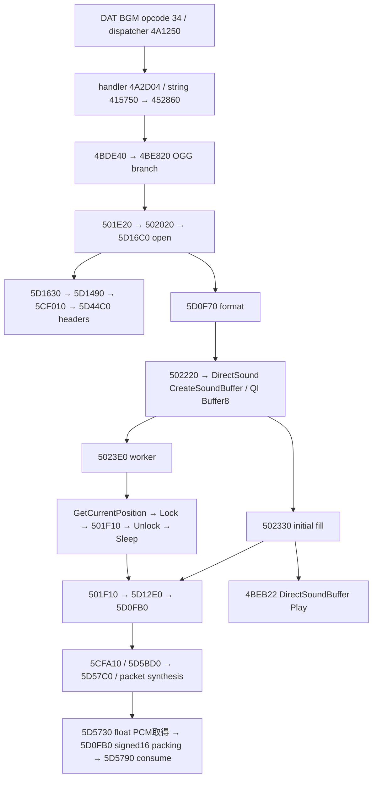
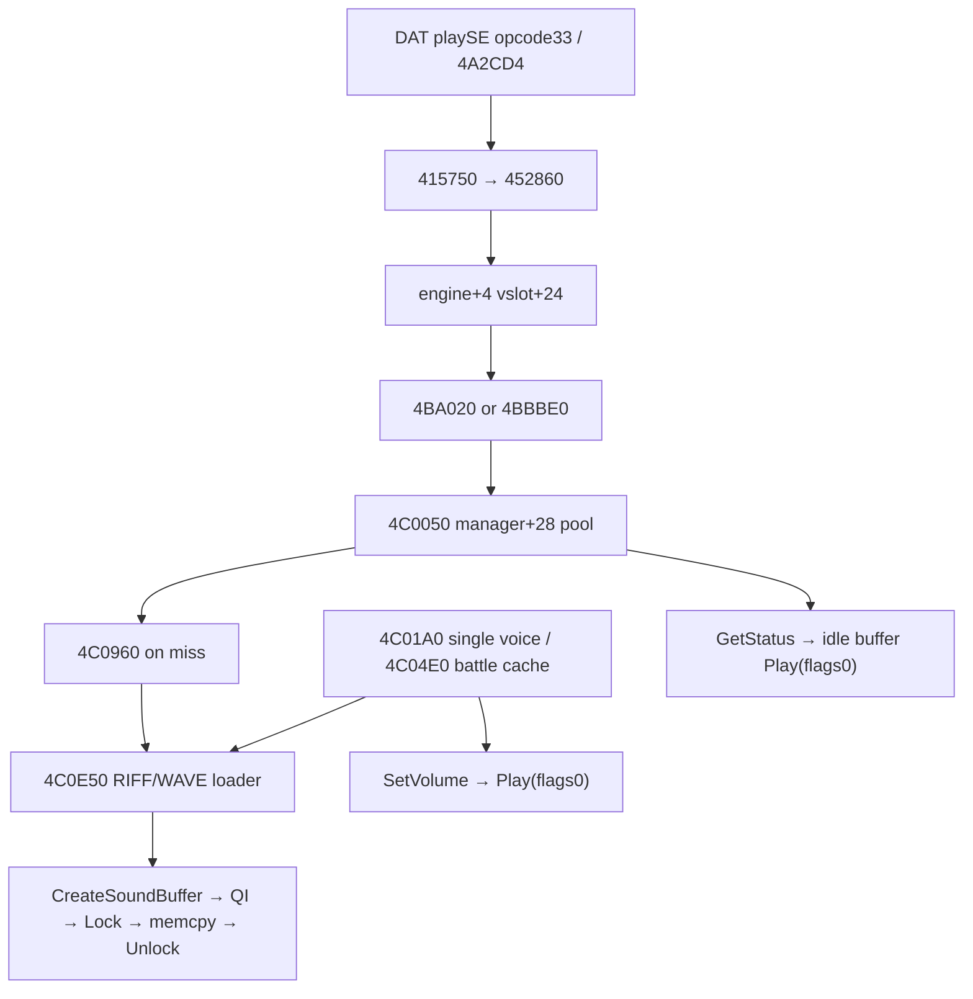

# REA-T015-OGG-REUSE-20261105 — Vahren 0.67 OGG再利用設計

Status: **OWNER_INTAKE / NOT CURATED / DLL再利用は未実証**  
対象: 原作32bit Vahren.exe。製品変更なし。研究日: 2026-11-05。担当: REA。

## 判定

既存OGG/Vorbis処理は、ファイル単位の外側状態を呼び出し側で用意し、原作側でopen/read/clearを完結させる境界を持つ。**方式B（既存デコーダ＋DLL管理のPCM/音声出力）を第一候補にできる静的根拠がある**。しかし、DLLで新規状態を作る試験、原作BGMとの並行動作、失敗時解放、DAT文字列の安全な取得が未完了なので、「DLLから安全に利用できることを確認済み」とは判定しない。

今回の実機ログは原作の通常経路でopen成功5件、readのCALL/RETURN対応64件を観測した。これを新規DLLコンテキストの動作証明へ拡張してはいけない。提示された実行パスは通常のゲーム配置だったため、**ユーザー操作による実機観測であり、隔離診断コピーでの受入試験ではない**。

方式AはRIFF/WAVローダへPCMポインタを渡すだけでは成立しない。方式Cは原作ABIへの依存を除ける代替。WAVファイルへの変換、自動拡張子置換、原作BGMの停止は設計に含めない。

## 1. 証拠と重複の扱い

原作EXE SHA256: `e8dac301050c8e630d7e0ce93aeefd95e641207d9c0576017f62ba46a8767187`  
V9 SQLite SHA256: `2629cb2f03ecec9927e89892c77f847e4cdba381ab718825c1ca8cfeeef00ede`  
KB参照develop: `2919666733f4784f10c86813502d17d152fbf5ac`。README、CONTRIBUTING、REF_AUDIO_VORBIS、REF_SCRIPT_VM_CONTEXT、REF_DAT_BEHAVIOR、CORRECTIONS、関数・呼出辞書を参照した。出典は [SOURCE_RECEIPTS.tsv](SOURCE_RECEIPTS.tsv)。

証拠区分:
- **S**: V9既存解析と同一SHA原作x86の照合。逆コンパイルの推定型だけをABI根拠にしない。
- **R**: 今回の原作通常経路のログ。採取上限64、スレッド役割を匿名化。
- **M**: 独立した数式・整数演算の合成検証。ゲーム/デコーダを実行しない。
- **D**: 次の実装担当向け設計。実装済みではない。
- **U**: 未確定。正式関数辞書採録は統合担当の検証後。

今回の価値は、既存の深部Vorbis研究を再発見扱いすることではなく、DAT→出力APIの経路、WAV側との差、独立DLLの境界候補、runtimeとの対応を接続した点にある。負のreadのunsigned加算、1領域fill、半バッファのframeずれ、implicit ESI、teardownは先行研究を継承。新しい訂正候補はWAVローダの戻り値/スタック引数等を含むが、共有symbols.tsvは変更しない。

[静的監査](audit_01/AUDIT_SUMMARY.json)は37対象関数について50範囲、340 direct CALL/tail edge、30境界命令を照合。50は関数個数ではない。間接CALLの全解決、全経路のABI証明、メモリ安全性証明ではない。[CALL_EDGES.tsv](audit_01/CALL_EDGES.tsv)、[BOUNDARY_SITES.tsv](audit_01/BOUNDARY_SITES.tsv)、[FUNCTION_WINDOWS.tsv](audit_01/FUNCTION_WINDOWS.tsv)を住所検索に使える。

## 2. DAT BGMから音声出力まで

以下のアドレスはpreferred image base 0x00400000のVA。実行時はmodule base + RVAを使う。今回のスクリーン表示ではbase 0x00750000、0x009216C0は静的0x005D16C0に対応した。スクリーン内容そのものは保存対象にしない。



| 経路 | CALL/命令位置と意味 |
|---|---|
| DAT入口 | 0x4A2DA8 CALL 0x4BDE40。0x4A2D04はdispatcher内handler位置で独立関数ではない |
| BGM管理 | 0x4BE178 CALL 0x4BE820。OGG分岐で0x4BEA95 CALL 0x4BDAF0 path解決 |
| 確保/構築 | 0x4BEA9C push 0x3E8、0x4BEAA8 allocator、0x4BEAD9 CALL 0x501E20 |
| 開く | 0x501E93 CALL 0x502020、0x502038 CALL 0x5D16C0(path, object+0x118) |
| 原作CRT FILE | 0x5D16CF CALL 0x5D1D6D(path,"rb")、0x5D1712 CALL 0x5D1630 |
| ヘッダー | 0x5D165F CALL 0x5D1490、0x5D1572 CALL 0x5CF010、0x5CF167/0x5CF279 CALL 0x5D44C0 |
| 形式 | 0x502060 CALL 0x5D0F70(ctx,-1)、channels/rate読出、bits=16 at 0x502071 |
| DS準備 | 0x4BEAE9 ESI=[player+0xA0]、0x4BEAEF CALL 0x502220。0x50224F CALL 0x502100でWAVEFORMATEX作成 |
| 出力バッファ | 0x5022C4 COM vtable+0x0C CreateSoundBuffer、0x5022D9 QueryInterface(IID at 0x60971C)、0x5022E5 temporary Release |
| prefill/worker | 0x5022E9 CALL 0x502330、0x502300 CALL 0x5B7D14 __beginthread(0x5023E0,0,stream) |
| 再生 | 0x4BEB22 COM vtable+0x30 Play(this,0,0,1)。DirectSound再生バッファにloop flag=1を指定。ファイルループは別状態 |

実際の出力境界はDirectSound COMであり、5D44C0や5D57C0自体に音声出力機能はない。COM呼出しの引数・vslot、IID、実体接続を根拠に区別した。Playのloop flagについては[Microsoft資料](https://learn.microsoft.com/en-us/previous-versions/windows/desktop/ee418074(v=vs.85))も照合。

worker 0x5023E0は0x502330を呼ぶのではない。自分のループでcursor取得(0x502445)、Lock(0x502479/0x50250D)、decoder vslot fill(0x50249E/0x50252E)、Unlock(0x5024BD/0x50254D)、Sleep(0x502567)を実行する。2領域Lockのうちfillが第一領域しか受け取らない既知条件を、DLL設計へ継承してはいけない。

## 3. 初期化からPCM生成まで

0x5D16C0は原作CRTでファイルを開き、0x5D1630にcallbacksを値渡しする。read=0x5B77CB、seek=0x5CFDD0、close=0x5B7A4E、tell=0x5B797C。DLL CRTで作ったFILE*を渡す必要はない。

0x5D44C0はinfo/comment/packetのヘッダー解析で、type 1/3/5から0x5D3F60/0x5D4030/0x5D4160へ進む。seekable情報の準備には0x5D1310も関与する。これら単独ではファイルコンテキスト一式を生成できない。

PCM read:
1. 0x501F91 → 0x5D12E0(ctx, out, length, 0, 2, 1, &section)。
2. 0x5D1303 → 0x5D0FB0へ9個のstack引数（上記7個と追加0,0）。0x5D12E0は結果EAXを保持してRETする。V9のvoid表示を採用しない。
3. 0x5D0FE1 → 0x5D5730(ctx+0x1E0,&floatPCM)。不足時は0x5D0FF8でEAX=ctx、0x5D0FFA → 0x5CFA10。
4. 初期化経路は0x5CFA45 → 0x5D5BD0(dsp,info) → 0x5D57C0(dsp,info,0)。0x5D5BFB → 0x5D4D20、0x5CFA5D → 0x5D4900(dsp,block)。outer+0x58がstate4へ。
5. packet取得0x5CFA9F → 0x5D3BC0、synthesis 0x5CFACF → 0x5D45E0。mode/bitreaderとmapping間接dispatchを含む。mapping全候補を今回新規に全解決したとはしない。
6. overlap/add 0x5CFC86 → 0x5D4D90、PCM available 0x5CFC94 → 0x5D5730。
7. 0x5D0FB0内でfloat×32768（0x60CDD8のdouble定数）、0x5D114F FISTP、[-32768,32767] clamp、0x5D1171付近word格納/strideでinterleaved signed16へ変換。x87丸め環境は今後のbit-exact比較条件。
8. 0x5D128D → 0x5D5790(dsp,frames)で消費、0x5D12BAでframe bytes×framesをEAXに返す。0x5CFA10の-2は0x5D12CFで0へ正規化。他の負値は保持される。

上流[ov_read仕様](https://xiph.org/vorbis/doc/vorbisfile/ov_read.html)との形状一致は補助証拠。原作組込み版が同一バージョン・無改変であるという証明ではない。1回のreadは要求長より短く返り得るため、戻り値ぶんだけ出力長を進める必要がある。

## 4. ABIとメモリ所有権

以下はSによる**限定的な呼出し規約候補**。C宣言は設計表現で、直接呼出し可能と認定したSDKではない。

| VA / RVA | 引数・戻り値 / 規約候補 | メモリ・条件 |
|---|---|---|
| 0x5D16C0 / 0x1D16C0 | stack(path,outer)、EAX signed status、caller cleanup/cdecl候補 | outer backingはcaller、内部FILE/heapはhost。通常成功は0 |
| 0x5D0F70 / 0x1D0F70 | stack(outer,index)、EAX info*、cdecl候補 | 返却infoは借用。+4 channels、+8 rate。clear/状態変更後に保持しない |
| 0x5D12E0 / 0x1D12E0 | stack(outer,out,len,endian,word,signed,section*)、EAX signed bytes、cdecl候補 | out/sectionはcaller。0 EOF、負値error。0,2,1でsigned16LE |
| 0x5CFE00 / 0x1CFE00 | stack(outer)、EAX 0、cdecl候補 | 内部解放とouter 0x2D0 zero。outer本体はfreeしない |
| 0x5D0E90 / 0x1D0E90 | stack(outer,double seconds)、EAX signed status、cdecl候補 | seek時の状態更新。0秒巻戻し候補。失敗を無視しない |
| 0x5D44C0 | stack(info,comment,packet)、status、cdecl候補 | packet/header専用。公開再利用境界にしない |
| 0x5D57C0 / 0x5D5BD0 | dsp/info/mode、dsp/info | 深部初期化。outer/callback/headersを代替しない |
| 0x5D1490 | EAX=FILE、ESI=outer、stack initial/len/callbacks | カスタムABI。通常C宣言で直接呼ばない |
| 0x5CFA10 / 0x5CF970 | incoming EAX=outer / incoming ESI=outer | カスタムABI。前者stack 0,1,1を伴うread経路、後者state gate |
| 0x501E20 | stack(storage,path)、ret 8、EAX=this | ECX ctorと誤認しない |
| 0x502020 | ECX=this、stack path、ret 4、AL bool | path固定領域への無境界copyがある |
| 0x501F10 | ECX=this、stack(out,len,actual*,eof*)、ret 0x10 | 負readをunsigned加算する既知挙動。DLL境界から除外 |
| 0x502330 | EAX=stream | prefill。裸のPCM供給APIではない |
| 0x502220 / 0x502160 / 0x5021E0 | EAX=decoder,ESI=stream / EAX=stream / ESI=stream | device/thread/所有権の結合が強い |
| 0x4BDE40 | ECX=filename、stack 6 args、ret 0x18 | 原作BGM状態に作用 |
| 0x4C0E50 | stack(manager,path,voiceFlag)、ret 0x0C、EAX=buffer/null | WAV loader。V9 void表示の訂正候補 |
| 0x4C0960 | ECX=name、stack manager、ret4、EAX=pool | SE cache作成。標準thiscallのthis推定に注意 |
| 0x4C0050 | ECX=manager、stack name、ret4 | poolから再生。raw PCM入力なし |
| 0x4C01A0 | stack(manager,name,mode)、ret0x0C | 単一voiceの停止/置換 |
| 0x4C04E0 | ECX=manager、stack name、ret4、EAX=buffer | battle cache。戻り値訂正候補 |

元のOggDecoderは0x3E8 bytes:
- +0 vptr=0x6395CC。slots: deleting dtor 0x501DF0 / fill 0x501F10 / rewind 0x502000 / load 0x502020 / clear 0x501EB0。
- +4 software loop、+5 ready、+6 char[0x100] path。
- +0x108 channels、+0x10C rate、+0x110 bits。
- +0x118 outer[0x2D0]、outer+0x58 state、outer+0x1E0 dsp、outer+0x250 block。
- low-level方式Bならpath固定配列を含むこの上位object全体は不要。ただしouterを公開上流ヘッダーのsizeofで置換してはいけない。

BGM streamは0x5C bytes:
- +0 owned decoder、+4 DS device、+8 DSBuffer8。
- +0x0C WAVEFORMATEX(0x12)、+0x20 DSBUFFERDESC(0x24)、+0x28 buffer bytes。
- +0x44 ready、+0x48 thread handle、+0x4C quit、+0x4D loop。
- +0x50 state 0/1/3、+0x54 EOF actual threshold、+0x58 half phase。
- PCM tag1、16bit、blockAlign=2×channels、avgBytes=rate×blockAlign。
- 原作は約1秒のN bytesをH=N/2に分割。odd rateでHがframe境界に合わない条件がある。DLLではframe数から容量を決定する。

## 5. 再生・停止・音量・解放

software loopは0x4BEB0F/0x4BEB12でstream+0x4D/decoder+4へ。DS Playはloop=1で回し、EOFの実長・phaseで停止判定する構造。0x502580(ESI stream)から0x4BF780、0x4BE220にplaylist遷移がつながる。

DAT stop opcode35 handler 0x4A2DC8、CALL 0x4A2DD3 → 0x4BE1C0 → 0x4BF2B0(ESI player, stack clear flag,ret4)。0x4BF30B state=3、0x4BF318 COM Stop、0x4BF31C prefill 0x502330が**joinより前**にある。0x4BF327 → 0x502160 → 0x5021E0でquitとWaitForSingleObject(thread,100)反復。100msは総待機上限ではない。0/-1で抜ける条件も完全な正常終了証明にはしない。

0x5021A5 buffer Release、0x5021B2 decoder clear、0x5021C0 deleting dtor(flag1)。0x501EB0はreadyを見てclearし、状態をゼロにする。示した正常経路でdtorから再度来ても内部を二重closeしない仕組み。ただしopen失敗ごとの所有権は追加検証対象。

volume 0x4BF630(EAX player,ECX attenuation) → 0x4BF66B COM+0x3C SetVolume。BGM側clamp -9600..0、SE側-10000..0。再openは不要。[DirectSound SetVolume](https://learn.microsoft.com/en-us/previous-versions/windows/desktop/ee418150(v=vs.85))の対数単位と、DATで公開する音量尺度は分離して設計する。

## 6. WAV効果音・ボイスとの比較



playSEのtable 0x638DF0→0x4BA020、0x638E1C→0x4BBBE0。table格納は0x553ACB/0x553B4Fからglobal 0x8BE2F0。0x4BA020は同名200ms抑制や@/空間処理を含む。0x4BBBE0には同じ抑制がない。CALL 0x4BA1C0/0x4BBC4Aで0x4C0050へ。

0x4C0050: manager+0x28 cache、missで0x4C0115→0x4C0960。0x4C0148 GetStatusで非再生bufferを選び、0x4C017D Play(flags0)。全buffer使用中なら新規再生しない。voice stealingを保証する経路ではない。

0x4C0960: path解決0x427190、0x4C0B81→0x4C0E50(manager,path,0)。DuplicateSoundBuffer 0x4C0CEF、QI 0x4C0D04、Release 0x4C0D12でpool作成。複製はPCMを共有し再生状態は別。[Microsoft仕様](https://learn.microsoft.com/en-us/previous-versions/windows/desktop/ee418041(v=vs.85))と一致するがpool上限は原作設定に依存。

0x4C0E50:
- flag0は0x4C0E8D mmioOpenA。flag1はCreateFile/read＋独自前処理＋memory mmio。
- RIFF/WAVE/fmt/dataを探索し18byte formatを読む。0x4C104EでPCM tag1判定。
- 全data用temporary heap、0x4C1125 CreateSoundBuffer(desc 0x24, flags 0x80, data bytes)。
- 0x4C114C QI Buffer8、0x4C1158 temporary Release。
- 0x4C1177 Lock、0x4C1196→0x5B8730 memcpy、0x4C11B6 Unlock。
- 0x4C11CA temporary PCM free、0x4C11D7 voice raw free。
- 0x4C11DF EAX=buffer、0x4C11FB ret0x0C。失敗の0x4C1031はEAX=0。
- 従って「void」型ではない。**raw PCMを受ける独立した入口は示されていない**。途中アドレスにjumpする案はstack/所有権を破壊するため採用しない。

single voice 0x4C01A0: manager+0x34の旧bufferを0x4C020E Stop/0x4C0219 Release、0x4C046E loader flag1、0x4C0491 SetVolume、0x4C049F Play。caller 0x434D8D/0x4A1BD0/0x578737。新voiceで旧voiceを置換する。

battle voice 0x4C04E0: manager+0x40 cache、+0x4C recency、+0x50 count、+0x58 limit。0x4C082F loader flag1、0x4C08C9 statusで非再生entryをevict、0x4C08DC Stop/0x4C08E4 Release。0x4C0924 volume/0x4C0932 Play。同じkeyは同じbufferなので同名voiceの独立多重再生を保証しない。caller 0x403C3A/0x405090/0x440D0A/0x49269D。

| 項目 | BGM OGG | WAV SE | Voice |
|---|---|---|---|
| PCM | Vorbis→signed16LE interleaved固定 | RIFF fmt由来のPCM | 前処理後WAV/PCM |
| データ寿命 | decoder＋循環buffer＋worker | 全PCMをbufferへcopy後temp解放、pool保持 | currentまたはcache buffer保持 |
| 同時再生 | 原作BGM managerに結合 | idle duplicate pool内 | singleは置換、battleはcache別entry |
| スレッド | main prefill＋専用worker補充 | 今回64件mainで観測 | 今回未観測 |
| 停止/音量 | 状態/worker/EOF管理 | pool/manager単位の既存管理 | current/cache所有権へ結合 |
| OGG PCMの受け渡し | low-levelから取得可能候補 | WAV loaderへ直接は渡せない | 同左、voice前処理も別 |

4BFBF0はpools/cache/current/deviceの解放。4BFD40はSE volume(+0x60,+0x68)、4BFF60はvoice(+0x70,+0x78)、4BFFD0はbattle(+0x80,+0x88)。後者のimplicit ESIを含む全ABIは今回認定しない。SE関数内でworkerやmutexが見えないことから全thread安全とは結論しない。

## 7. 実機ログの結果と限界

[集計](audit_01/RUNTIME_SUMMARY.json)、[対応表](audit_01/RUNTIME_READ_PAIRS.tsv)。raw logはローカルのみ、SHA256 `1693420efdca2794e69669817ef6c59177705dd78e6230dc3b829db3bf8677cf`、3,102,306 bytes / 78,133 lines。

| 観測 | 結果 |
|---|---|
| open return | 5件、すべてEAX=0、main |
| read CALL/RETURN | 各64件、tid/ctx/out/request/espによる対応64、未対応return 0 |
| read返却bytes | 0x1000×43、0x900×6、0x200×13、0xA10×1、0x5F0×1 |
| read thread | main50、worker14 |
| fill return | 64、main3/worker61 |
| worker入口 | 5件、5 worker IDs |
| SE入口 | main64件 |
| clear入口 | main5件。完了/漏れなしの証明ではない |
| voice入口 | 0件。voice runtime検証なし |
| 終了 | process exit code0の文字列あり、スクリプトEND markerなし |

要求以上のread、負read、EOFの0は採取範囲で0件。全再生の保証ではない。prefillでは0x2B110=176400、worker側では0x15888=88200のfillを観測。PCM内容・音の正しさ・DirectSound HRESULTは記録していない。新しいDLL contextのopen/read/clearも実施していない。

v1は独立した各probeの64回log上限のみでBPを無効化しなかったため、x64dbg pluginが大量のhit通知を出した。古い既に消えたBPへのbpd警告もあったが、ARMEDと観測が続いた。v2は各probeが64回で自己無効化するよう修正した。**v2はソース確認のみ、未実行**。次回はログ方式を継続し、スクリーンショット提出は不要。

11合成ケースは負値unsigned wrapとframe境界の計算だけ。原作デコーダを動かしてクラッシュ・誤音を再現したテストではない。

## 8. A/B/C比較

| 方式 | 難易度 | 侵襲性/互換性 | 負荷 | 主なクラッシュ条件 | 残る解析 |
|---|---|---|---|---|---|
| A 既存decoder＋既存SE | 高 | manager/cache/COM所有権へ接続。原作volume系との親和性はあるが寿命に依存 | decode cache＋複製で抑制可能。測定なし | wrong this/ret、pool破損、device解放後使用、別thread操作 | PCM factory切出し、manager thread、eviction、全破棄順 |
| B 既存decoder＋DLL音声管理 | 中〜高 | 原作codecへの依存を5境界へ限定。独立sinkでBGMを維持 | decode量はA同等候補、短音cache/長音stream。測定なし | ABI/outer寸法誤り、host heap誤free、readとclear競合、共有codec状態 | 新規context、同時BGM、失敗所有権、DLL worker条件 |
| C 独立decoder＋DLL音声管理 | 中 | 原作内部ABI不要。原作とcodec版/対応入力/丸めが異なる可能性 | 同系codecなら同程度候補。追加コード/依存増、未測定 | 自前queue/sink/寿命の不備 | library/license選定、format/負荷/出力検証 |

既存コード量が少ない順と安全性は一致しない。Bの残存gateが満たせなければCへ切替。Aは原作SEとの音量統合等が必須になった場合に追加研究する。Bで既存DS deviceを無断借用すると再びAの寿命問題を持ち込むため、第一段階はDLL所有sink/deviceを使う。

## 9. 方式Bの具体設計（未実装）

### 9.1 境界と状態

```cpp
// 設計用候補。ABI/runtime gates完了まで製品に組み込まない。
struct alignas(16) HostVorbisState { unsigned char opaque[0x2D0]; };
using HostOpen = int (__cdecl*)(const char*, HostVorbisState*);
using HostInfo = const void* (__cdecl*)(HostVorbisState*, int);
using HostRead = int (__cdecl*)(HostVorbisState*, char*, int, int, int, int, int*);
using HostClear = int (__cdecl*)(HostVorbisState*);
using HostSeekTime = int (__cdecl*)(HostVorbisState*, double);
// module base + RVA。外部DLLへ上記VAを固定して呼び込む実装ではない。
```

起動時に32bit/EXE SHA/境界命令fingerprintを照合。不一致なら機能を無効化し既存音声に影響を与えない。ASLR補正を行う。opaqueをゼロ初期化、外側backingのみDLLが所有する。内部heap/FILEはhostが所有。hostのclear以外でfreeしない。DLL CRT FILEを渡さない理由は[VorbisfileのWindows初期化注意](https://www.xiph.org/vorbis/doc/vorbisfile/OggVorbis_File.html)とも整合する。

状態機械: Empty → Opening → Ready → Decoding → EOF/Error → Clearing → Closed。open成功後のみclearを一度実施。open失敗時は各失敗枝の自動cleanupの有無を調べ、無条件clearで二重解放しない。構造体をbyte copyで複製しない。

各contextに単一owner workerを設け、open/info/read/seek/clearを直列化する。callback/VM threadで長時間decodeしない。DllMainから初期化・待機・decodeしない。上流はインスタンス単位の直列化を案内するが、原作組込み版の複数context並行安全性は別gate。[upstream threads](https://xiph.org/vorbis/doc/vorbisfile/threads.html)

### 9.2 PCMと音声

read固定flags=0,2,1。符号付き戻り値を先に判定し、正値だけbuffer cursorへ加算する。0 EOF、負値は原則停止/明示error。recoverable holeを再試行する場合も回数・時間に上限を設ける。seek失敗時に無限loopしない。sectionが変わったらinfoを再確認し、ch/rate変更は第一段階では拒否。lenはINT_MAX以下でframe倍数、返却長・out境界・演算overflowを検査。

初期対応範囲をmono/stereo、一定rate、通常seekable file、2GiB未満とするのは**設計上の制限**であり、原作がそれ以外を絶対再生できないという結論ではない。host seek/tellの32bit制限とANSI pathの文字コードは検証する。

短いSEは一度全decodeし、immutable PCM cacheを参照する独立voice handlesで同時再生。これはメモリPCM化でありWAVファイル変換ではない。長いvoiceはframe数基準のring bufferを補充する。声ごとにcursor/volume/loop/stopを保持し、同名多重再生にも別handleを返す。

sink候補はDLL所有DirectSound secondary buffers。device初期化/coop level/format対応はAPI側の実装検証対象。Lockが二領域を返したら両領域へ必要量を書き、Unlockへそのまま対応させる。[Lock](https://learn.microsoft.com/en-us/previous-versions/windows/desktop/ee418073(v=vs.85)) / [Unlock](https://learn.microsoft.com/en-us/previous-versions/windows/desktop/ee418153(v=vs.85))。原作BGM stream管理を再利用しない。

音量0..100等のDAT尺度をDLL内で定義してsink単位へ変換する。stop(handle)とstopGroupを分離、loopは再生単位の状態。handleにgenerationを含め古いstopが新voiceに作用しないようにする。voice上限とPCM cache上限、上限超過時の拒否/steal policyを明記する。

終了: 新規command受付停止→cancel→decode/出力workerをdrain/join→host clear→sink buffer/device Release→cache解放→DLL unload。原作容器をDLL workerから操作せず、force thread killを使わない。

## 10. DAT routine busと任意path

参照: DAT_ROUTINE_BUS.md / hakushin_dat_routine_bus.h / work_dat_routine_bus.h、および製品HEAD `d4037feb660b5cc5af08f752b69c571f0832db5b` のhakushin_exp_dat.h。出典SHAはledger参照。

既存busはevent 0x484B4452、52byte payload(size/version/evaluator/vm_context/thread_id/name[32])。**literal引数が厳密に1個**、hk_ prefix、name 4..31 bytes。hk_ui_select_v1..v4は除外。同期callbackは元dispatcher前に呼ばれ、その後も原作処理は進む。hook sites A=0x433B62、C=0x49356A、B=0x433754 → 0x4A1250。

従ってroutine(hk_audio_v1,path,volume)のような多引数は現在のbusでは届かない。event nameに任意pathを詰める設計も不適切。VM pointerは借用で、queueに保持してはいけない。

設計案は**固定通知名＋VMデータの同期snapshot**:
1. DATで新設の文字列配列にpath 1要素、数値変数にop/request_id/handle/volume/loopを設定。
2. routine(hk_audio_v1)を発行。これは設計名で、現行実装済みAPIではない。
3. callbackでVM contextとversionを検査し、長さ上限付きでpath/数値を読みDLL所有commandへcopy。
4. bounded queueへ投入、callbackは即時復帰。実際のfile/decodeはworker。
5. request_id→受付結果/voice handle/非同期errorを照会可能にする。queue受付成功と音声再生成功を混同しない。

既存EXP実装のnumeric mapはctx+0x4C4、node+0x28、record+0x1C。文字列配列mapはctx+0x1E8B40、node+0x28 begin/end/cap、stride0x1C（28 bytes）。既存hxd_namesの64byte名称用読取を任意path APIとして流用してはいけない。SSO/heap、長さとcap、NUL、文字コード、VM有効期間の境界を確認して専用bounded readerを作る。これらoffsetの適用先VM種別も再確認する。

pathは定義済み音声rootからの相対pathを基本とし、空文字/埋込NUL/絶対path/UNC/上位脱出を拒否。正規化後の所在を検証し、ANSI変換が不可なら明示error。必要ならroot内のjunction等を含む最終解決先も検証する。拡張子だけで内容の妥当性を保証しない。共有DAT変数の割込み・再入による混在を避け、callbackで一括snapshotできるプロトコルを検証する。

暫定の短ID→DLL manifestは安全な先行試験に使えるが、**任意path指定という最終要求を満たしたことにはならない**。今回DATパスreader実装/動作試験は未実施。

## 11. 残るgateと次担当の手順

| 優先 | 作業 / 合格条件 | 今回 |
|---|---|---|
| G1 | 隔離コピー＋同一SHAをmanifest固定、既存BGM/WAV baselineと終了をlog採取 | installed-game観測のみ |
| G2 | host boundary 5種のstack前後/保存register/戻り値、失敗open所有権を確認 | native命令と通常read観測のみ |
| G3 | 独立診断DLLで新規outerをopen/read/clear、成功/失敗/再open/空/不正/切詰め入力を有界試験 | 未実施 |
| G4 | 原作BGM＋独立2context、stop/read競合を直列化、反復create/destroy、メモリ/handleの増加なし | 未実施 |
| G5 | PCM長/形式/参照decode比較、EOF/loop/seek失敗/chained format/x87条件 | 未実施 |
| G6 | DLL sinkで同名多重/別名多重/音量/個別stop/loop/終了、既存WAV/BGM共存 | 未実施 |
| G7 | VM別path snapshot、長さ/encoding/reentry/queue-full/error応答 | 未実施 |
| G8 | 合格後に製品統合、KB統合担当が訂正/関数辞書採録 | 未実施 |

実装順序はG1→G2→G3の診断専用adapter→G4/G5→sink→DAT→製品統合。G2/G3で不成立なら独立decoderの方式Cへ切替し、同じPCM/sink/command設計を使う。G3より先にABI未確定の深部関数を手動callしてはいけない。

追加静的対象は、open各失敗枝のFILE/heap所有権、codec共有globalのwrite集合、allocator初期化、seek/tellのrange、chained streamのformat変化、DAT string readerの具体レイアウトとVM適用範囲。deep mappingの全再解析はこれらのgateを先に満たす目的には必須ではない。

次のruntime採取では、既存通常経路のRETURNとHRESULT/formatを追加し、必要な時だけ停止する。保存するlogにmodule SHA、probe revision、BEGIN/END、thread/instance相関ID、signed resultを含める。今後はスクリーンショットではなくスクリプトとログを正本とする。

## 12. 保全・再現

原作EXE、DAT、音声、SQLite、raw log、ローカル絶対pathはアップロードしない。監査/集計スクリプトは入力pathを引数で受け、監査はread-only。スクリプトとTSVの採録はowner intakeだけで、developや正式辞書への反映は統合担当に委ねる。既存hold研究には触れていない。

再現:
```text
python audit_ogg_boundary.py --exe <authorized-exe> --v9 <readonly-v9> --out <new-output-dir>
python summarize_x32dbg_log.py --help
```
監査依存はPython pefile/capstone。環境への新規installや原作起動を監査スクリプトは行わない。集計スクリプトの実引数はそのhelpに従う。Mの11件を実機成功件数に含めない。

[x32dbg probe v2 template](x32dbg_ogg_probe_start_v2.txt)は未実行。relative logはdebuggerの作業ディレクトリに出るため、運用時は診断用出力先を明示して使用する。先に対象SHAとprobe位置を確認し、既存同位置BPを使用中なら上書きしない。内部関数の強制call、register/dataの書換えは含まない。software BPによる診断instrumentationは行う。

本研究は「独立DLL再利用の技術的候補と試験条件を定義した」段階。原作通常再生の観測、静的ABI候補、未実装設計を混在させず、実装成功/音声品質/並行安全性/正式採録の宣言は行わない。
